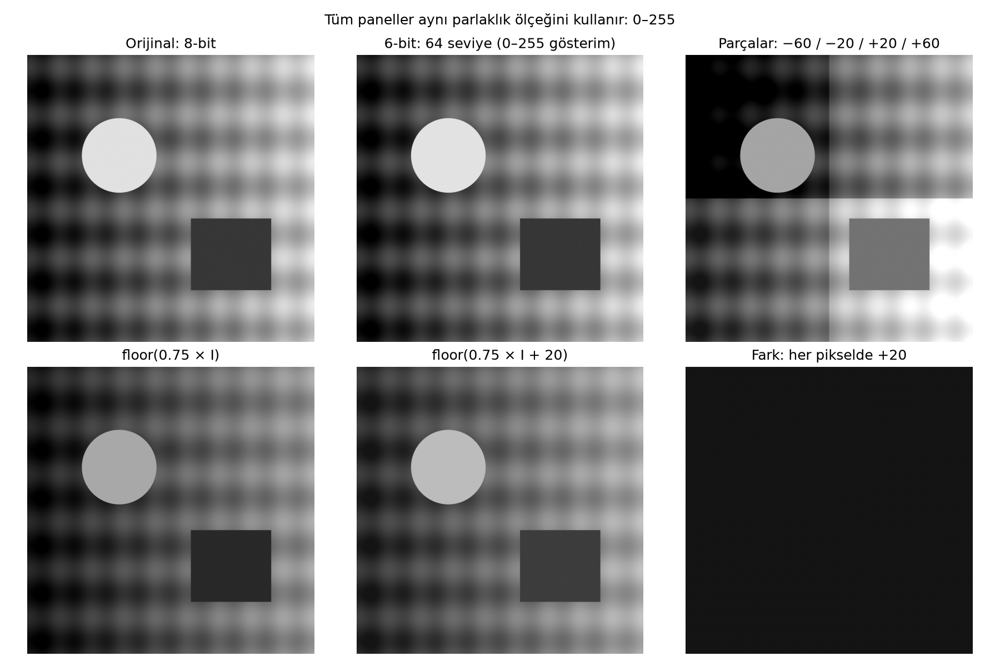
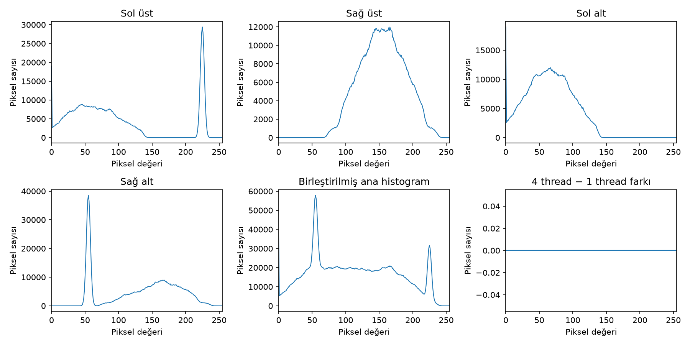

# Çok İş Parçacıklı Gri Seviye Görüntü İşleme

Bu proje, tek kanallı görüntüler üzerinde parlaklık nicemleme, bölgesel parlaklık değiştirme ve histogram hesaplama işlemlerini gerçekleştirir. Tek iş parçacığı ile dört iş parçacığının çalışma sürelerini karşılaştırır.

## Gerçekleştirilen işlemler

1. `I // 4` ile 8-bit görüntüyü 64 seviyeye (6-bit kodlarına) nicemleme.
2. Görüntüyü dört bölgeye ayırıp dört thread ile sırasıyla −60, −20, +20 ve +60 parlaklık uygulama.
3. Aynı parlaklık işleminin tek ve dört thread sürelerini karşılaştırma.
4. Dört yerel histogramı paralel hesaplayıp toplayarak ana histogramı oluşturma.
5. Histogram hesabının tek ve dört thread sürelerini karşılaştırma.
6. `floor(0.75 × I)` ve `floor(0.75 × I + 20)` sonuçlarını görsel ve sayısal olarak karşılaştırma.

## Kurulum ve çalıştırma

Python 3.10 veya üstü gereklidir. Terminali bu dosyaların bulunduğu klasörde açın:

```sh
python -m venv .venv
```

Sanal ortamı Windows PowerShell'de `.\.venv\Scripts\Activate.ps1`, macOS/Linux'ta `source .venv/bin/activate` ile etkinleştirin. Ardından:

```sh
python -m pip install -r requirements.txt
python goruntu_isleme.py --out sonuclar
```

Kendi görüntünüz için:

```sh
python goruntu_isleme.py --image "fotograf.jpg" --out kendi_sonuclarim --repeats 31
```

Renkli giriş otomatik olarak tek kanallı gri seviyeye dönüştürülür. Görüntü belirtilmezse 2048 × 2048 boyutunda sentetik bir test deseni oluşturulur. `--size 4096` seçeneği test deseninin boyutunu değiştirir. Gerçek görüntü verildiğinde yeniden boyutlandırma yapılmaz.

`ornek_sonuclar` klasöründeki rapor ve görseller örnek çalıştırmaya aittir. `olcumler.json` tüm ham süre ölçümlerini ve sayısal istatistikleri, `histogramlar.csv` dört yerel histogramı ve ana histogramı içerir. Nicemleme, bölgesel parlaklık, histogram ve doğrusal dönüşümler orijinal görüntüden bağımsız dallar olarak hesaplanır.

## Proje yapısı

```text
.
├── goruntu_isleme.py      # İşlemler, ölçümler ve doğrulamalar
├── requirements.txt      # Python bağımlılıkları
├── README.md
├── .gitignore
└── ornek_sonuclar/        # Kaydedilmiş örnek çalışma
    ├── rapor.md
    ├── olcumler.json
    ├── histogramlar.csv
    ├── histogramlar.png
    └── ...               # Giriş ve dönüşüm görüntüleri
```

## Örnek sonuçlar

2048 × 2048 sentetik test görüntüsü üzerinde, 3 ısınma turundan sonraki 31 ölçümün medyanı:

| İşlem | 1 thread | 4 thread | Hızlanma (T1/T4) |
|---|---:|---:|---:|
| Parlaklık değiştirme | 21,821 ms | 10,009 ms | 2,18× |
| Histogram hesaplama | 35,114 ms | 22,052 ms | 1,59× |

Bu değerler örnek çalıştırmaya aittir; donanım, görüntü boyutu ve sistem yüküne göre değişir. Dört thread her zaman daha hızlı olmayabilir.





Ayrıntılar için [sonuç raporuna](ornek_sonuclar/rapor.md) bakın.

## Yöntem ve doğrulama

- `ThreadPoolExecutor(max_workers=4)` gerçek iş parçacıkları kullanır. Piksel işlemleri NumPy ile yapılır.
- Her iki sürüm aynı dört parçayı işler. Tek thread bunları sırayla, dört thread görevler halinde hesaplar.
- Thread havuzunun ilk kuruluşu, disk işlemleri ve grafik üretimi ölçüm dışındadır. Görev gönderme, bekleme ve histogram birleştirme ölçüme dahildir.
- Parlaklık hesabı işaretli ara türde yapılır ve 0–255 aralığına kırpılır; uint8 taşması önlenir.
- Program, tek ve dört thread çıktılarının eşitliğini; histogram toplamının piksel sayısına eşitliğini ve ana histogramın doğrudan hesapla eşleşmesini `assert` kontrolleriyle doğrular.
- `6bit_kodlar.png`, 0–63 kodlarını 8-bit PNG taşıyıcısında saklar. Dosya fiziksel olarak 6-bit paketlenmiş değildir. Görsel karşılaştırmada kodlar 0–255 aralığına yayılır.
- +20 ekleme her pikselin değerini ve ortalamayı 20 artırır. Bu dönüşümde kırpma oluşmadığından standart sapma değişmez.

Görüntü sağlanmadığında kullanılan desen kod tarafından sabit rastgelelik tohumu (`42`) ile üretilir; harici görsel gerektirmez.
